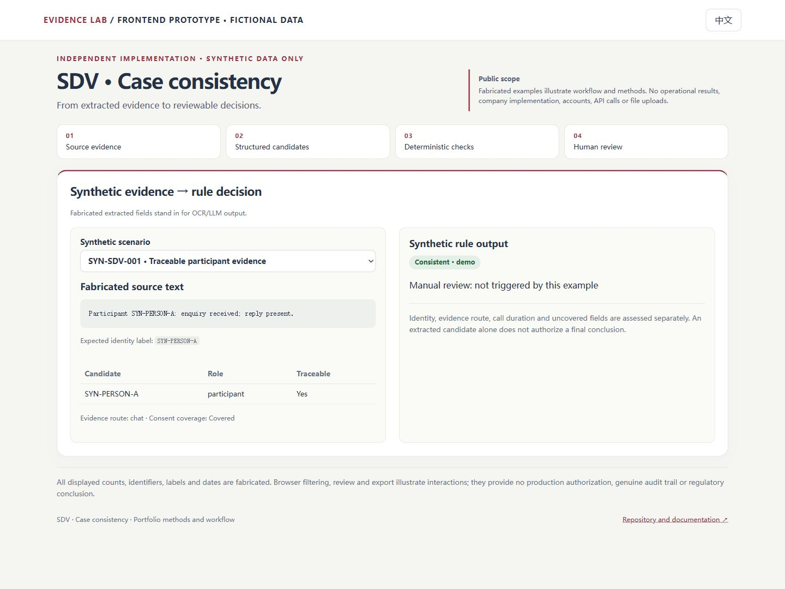
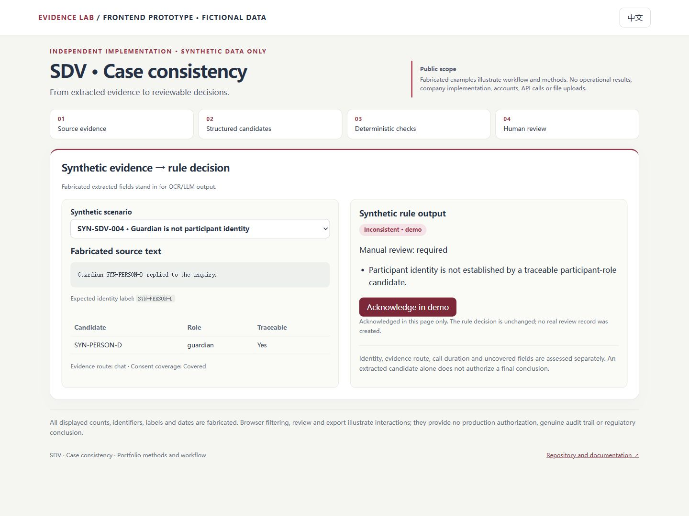

# SDV · Case consistency — synthetic public showcase

A synthetic illustration of source-to-record consistency, evidence provenance and manual-review routing. OCR and LLM extraction are represented by fabricated fields; this demo does not call either service.

This public repository contains **independently written demonstration code and entirely fabricated fixtures**. It is not a sanitized copy of a production system. No private Git history, company implementation, operational records, real study results, licensed terminology/templates, production screenshots, secrets or infrastructure configuration are included.

## Product preview

**Clinical consistency review workspace** — Keep fabricated source text beside consistency checks and manual-review decisions.

[**Open the interactive prototype →**](https://unravelreggie.github.io/demos/clinical-review/)

[](https://unravelreggie.github.io/demos/clinical-review/)

Switch scenarios to inspect missing evidence, identity ambiguity and review routing. The prototype runs in the browser with invented fixtures and local state only.

<details>
<summary>See a second workflow state</summary>



</details>

These are screenshots of this repository's independently written frontend, **not a company system**. Every record, count and output shown is fictional; no real data source or business situation is disclosed. No account or backend connection is required.

## Run locally

Requires Node.js 22.13 or later.

```sh
npm ci
npm test
npm run build
npm run dev
```

The development server binds to local loopback. The application makes no runtime network requests, has no accounts and accepts no uploaded files. It is independently buildable and has no dependency on another project or data directory.

## What to explore

- Source evidence
- Structured candidates
- Deterministic checks
- Human review

English and Chinese interfaces are provided. Every displayed example and calculated demo value is synthetic. Browser actions do not create real review records or provide production authorization.

See [architecture](docs/ARCHITECTURE.md), [data/publication boundary](docs/PUBLIC_SCOPE.md), and [methodology](docs/METHODS.md).

## 中文说明

SDV · 病例一致性核查的独立公开演示。所有示例均为重新编写的合成资料，用于展示功能、流程和方法；没有真实业务数据、结果或公司源代码。界面复核、过滤、导出与统计数值仅为演示，不能作为真实审计、监管或临床结论。

## Publication

This repository is a public code and frontend showcase. Its static build is available at the [portfolio prototype](https://unravelreggie.github.io/demos/clinical-review/); there is no backend, production-system connection, public tunnel or external integration. The private operational projects remain separate.
